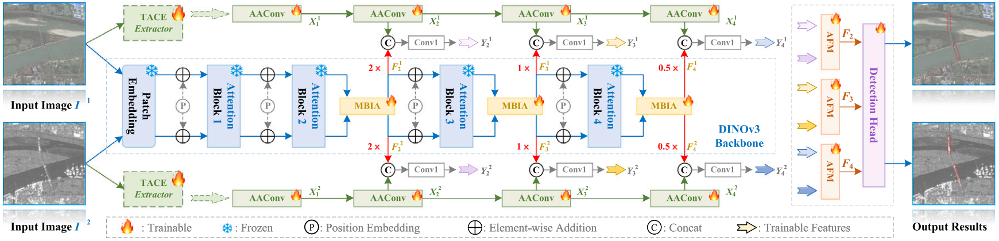
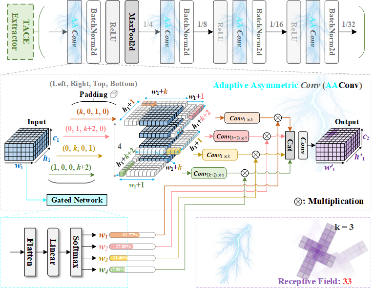
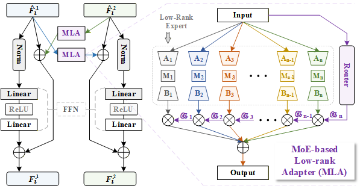
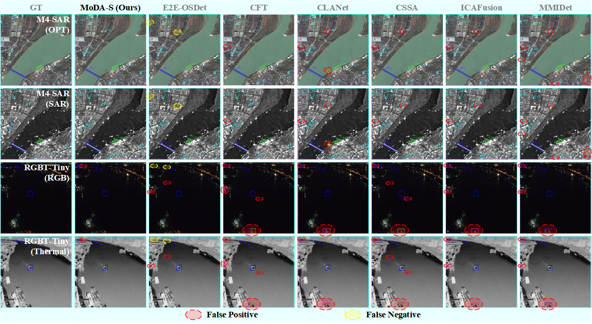

<div align="center">
<!-- <h1> MoDA: Unlocking Frozen Vision Foundation Models for Multimodal Fusion Object Detection in Remote Sensing </h1> -->
<h2> <a href="">MoDA: Unlocking Frozen Vision Foundation Models for Multimodal Fusion Object Detection in Remote Sensing</h2>
</div>

## News
- **2026.11.07** Congratulations! Our paper "MoDA: Unlocking Frozen Vision Foundation Models for Multimodal Fusion Object Detection in Remote Sensing" has been accepted by **ISPRS Journal of Photogrammetry and Remote Sensing 2026**. 🔥
  
#### This repository contains the official implementation of the paper: MoDA

## ✨ Overview

<p align="center">  </p>
<table>
  <tr>
    <td width="50%">
      
    </td>
    <td width="50%">
      
    </td>
  </tr>
</table>


## 📄 Documentation
### Installation
Create and activate a conda environment:
```
conda create -n moda python=3.11
conda activate moda
```
Install the required packages:
```
git clone https://github.com/wchao0601/MoDA.git
cd MoDA/
pip install torch==2.1.1 torchvision==0.16.1 torchaudio==2.1.1 --index-url https://download.pytorch.org/whl/cu118
pip install seaborn thop timm einops
pip install -r requirements.txt
```
### Data Preparation

| Dataset | Link1 | Link2 | Link3 | SR & Pola. | Image Size | Category | Ins.num | Img.num |
| :---: | :---: | :---: | :---: | :---:| :---: | :---: | :---: | :---: |
| M4-SAR | [Kaggle](https://kaggle.com/datasets/a8ca500cbad658d8ae1af3d1f84566a5b4e94fe0ddb0be801c9e2f672db36a57)|[Baidu](https://pan.baidu.com/s/14iuaf_2ymzpP68EJY0dUyg?pwd=0601)|[Hug-Face](https://huggingface.co/datasets/wchao0601/m4-sar)|10M, 60M, VH, VV|512 x 512|6|981,862|112,174|

### Model weights
|Weight Link |Code|
| :---: | :---: |
|[Download](https://pan.baidu.com/s/1G63DybXVP0n4-Wp0_MCcdQ) |0601|
### Train
```python
python train.py
```

### Test
```python
python test.py
```


## 📈 Results
<p align="center">  </p>

## 🌐 Contact
If you have any questions, please feel free to contact me via email at wchao0601@163.com

## 📚 Citation
If this work is helpful for your research, please consider citing:

## 🙏 Acknowledgment
- This repo is based on [Ultralytics](https://github.com/ultralytics/ultralytics), which is excellent works.
